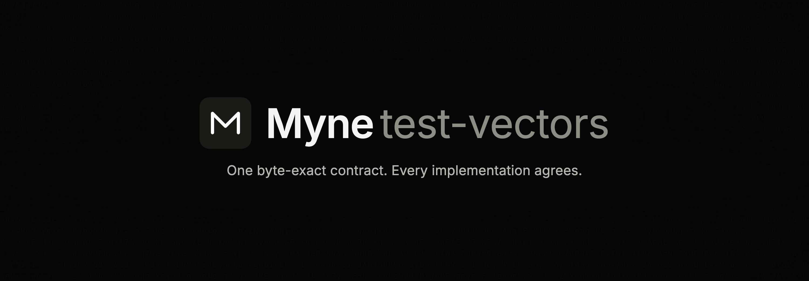

<p align="center"></p>

# Myne test-vectors

> One byte-exact contract. Every implementation agrees.

Language-agnostic JSON test vectors that pin the [Myne](https://github.com/myne-md/myne) cryptographic protocol at the byte level — v0.1 in full, plus the parts of the next major (v0.2) that are already frozen. Any independent implementation — Rust, Go, Swift, Kotlin, JavaScript, or anything else — must produce bit-identical outputs from these inputs. A reviewer verifying a port should not have to read the reference Rust implementation; running their own language's test runner against this repository is enough.

This is a companion repo of the [Myne multi-repo project](https://github.com/myne-md). The normative protocol lives in the main repo's specs — start with [`docs/spec/protocol.md`](https://github.com/myne-md/myne/blob/main/docs/spec/protocol.md), [`docs/spec/account-number.md`](https://github.com/myne-md/myne/blob/main/docs/spec/account-number.md), and the cross-implementation magic-byte and identifier tables. These vectors are the executable projection of that spec: every magic prefix, every AEAD AAD framing, every subkey role, and every coercion rule encoded as inputs and expected outputs.

## Status

**Pre-alpha**, tracking the v0.1 protocol and the frozen edges of v0.2. This repo holds data and schemas only — there is no build step and no code to compile here.

What exists today:

- **53 vector categories**, each under `vectors/<category>/` with a domain-semantic `schema.md` and at least one JSON-Schema-validated `<version>/cases.json` — 726 cases across 56 files.
- **Two protocol versions.** 52 categories have a `v0.1/`; four have a `v0.2/` (`crdt-note-blob`, which is v0.2-only, plus the `vault-meta`, `vault-themes` and `aad-construction` sides of the next major).
- A **canonical machine-readable contract** per version: the root schema `schema/<version>.json` dispatches per-category sub-schemas under `schema/<version>/` (one file per category) via `oneOf` keyed on the `schema` field. The two roots are separate documents because `protocol_version` is a `const` in each — see [Validating vectors](#validating-vectors).
- **Git hooks** (`lefthook.yml`): JSON well-formedness and text hygiene on commit, plus the full `ajv` schema sweep on push.
- **CI** (`.woodpecker.yml`): the same per-category `ajv` sweep on every push, pull request and manual run.

What is deferred:

- **Vectors for the rest of v0.2.** The next major is partly allocated — the `NC05` note type, the `NTV5` / `MYT5` envelopes, the `"myne.v0.2|"` AAD prefix, the `"myne.v0.2 "` HKDF context prefix and the `0x02` version byte are frozen and vectored; its KDF and remaining blob families are not allocated yet, so they are not vectored either.
- **Public availability, and with it the byte-level CI gate.** This repository is private for now, along with the rest of the pre-alpha project. The schema sweep above runs on every push; the *byte-level* conformance run against the reference implementation lives in the main repo and is currently commented out of CI, because cloning a private companion needs a secret and a CI config naming a secret it cannot see fails to compile at all. So the byte-level half gates on developer machines (`cargo test -p protocol --test vectors`, with this repo checked out beside the main one) and nowhere else. Until that changes, treat the paragraph at the top as the contract this repository is built to honour rather than one an outside reader can exercise today.

Every v0.1 blob family in the [`protocol.md` §10.3 magic-allocation table](https://github.com/myne-md/myne/blob/main/docs/spec/protocol.md) has a category, every `SubkeyRole` variant has an `hkdf-sha256` case, and every vault-scoped `aad_*` builder — v0.1 and v0.2 alike — has an `aad-construction` decomposition. Those three registries are enforced from the runner side (`SubkeyRole::ALL` and the builder lists are iterated, not restated), so a new role or family fails the suite instead of quietly shipping unvectored.

## How it works

Myne is end-to-end encrypted and local-first: a 20-character account number identifies you (no email), BIP-39 24-word recovery, Argon2id + XChaCha20-Poly1305. The same protocol runs whether sync is hosted or self-hosted — they share one trust boundary (TB5 in the threat model), so a vector that passes for one passes for both. These vectors are how independent clients prove they agree on the wire and on disk, down to the byte.

Each category pins one surface of the protocol. They fall into a few shapes:

- **On-disk blob codecs** — encrypt, decrypt-success, non-distinguishing AEAD-failure, and distinguishable structural parse-reject cases for each magic-prefixed format (`MY01` notes, `MYV1` vault metadata, `MYP1` prefs, `MYS1` search, `MYW1` workspace, `MYI1` indices, `MYA1`/`MYC1` attachments, `MYD1` dictionary, `MYQ1` quick-unlock, `MYE1` attachment-text, `MYB1` backup container, `MYR1` AI embeddings, `MYG1` graph layout, `MYK1` pending capture, `MYF1` share import, `MYT1` custom themes, `MYL1` sealed vault label). `MYH1` (`vault.head-state`) is the one family in this group that is **not** AEAD-encrypted — integrity is the vault head's own MAC — so it pins a `mac_fail` case kind instead of an AEAD-failure one.
- **Primitive derivations** — HKDF-SHA-256 subkey roles, Argon2id wrap-key derivations at canonical Phase 1 parameters, and the XChaCha20-Poly1305 + CTX-commitment AEAD with every AAD builder's canonical byte assembly.
- **Identity** — Crockford-base32 account-number parsing plus the frozen Damm-32 quasigroup table that decides which account numbers are valid.
- **Next-major (v0.2) formats** — the `NC05` CRDT note type, the `NTV5` vault-meta and `MYT5` themes envelopes, and the four v0.2 AAD builders. Each pins the two constants that make v0.2 a distinct major — the AAD prefix `"myne.v0.2|"` and the `0x02` version byte — and, more importantly, pins them in **both directions**: a v0.1 reader must refuse a v0.2 blob and a v0.2 reader must refuse a v0.1 one. A round-trip case alone passes in an implementation that ignores the magic entirely, which is the implementation these pairs exist to fail.
- **Deterministic conformance** — non-crypto, cross-client behavior such as phrase normalization, the password-length floor, the BIP-39 recovery composition, the note-template token engine, frontmatter property coercion, the `%%…%%` editor-comment recognizer, the clip serializer's canonical emit, the dialect parse-recognition categories (`footnote` / `highlight` / `wikilink` / `definition-list` / `inline-tag` / `math`), the task-field extension across all three read dialects and the one emitted form (`task-inline-format`) the closed recurrence vocabulary and its DST-immune civil-date arithmetic (`task-recurrence`), plus the closed task-query roster and the clauses it refuses (`task-query-grammar`), the frontmatter field patchers (`frontmatter-surgery`), the saved-views + color-group + pairing-token array decoders (`saved-view` / `color-group` / `paired-extension`), and the rename-journal crash-recovery state machine (`rename-journal`).

Vectors are not hand-typed where a generator exists: most are emitted by `#[ignore]`-gated generator tests in the main repo (`protocol/`, or `src-tauri/` for the std/fs-bound `backup-container` + `rename-journal`), so regeneration is always a deliberate act. The TS-runner categories are emitted by env-gated vitest generators (`d1-clip-serializer`, `footnote`/`highlight`/`wikilink`/`definition-list`/`inline-tag`/`math` via `GEN_DIALECT_VECTORS=1`, `frontmatter-surgery` via `GEN_FM_SURGERY=1`, `task-inline-format`/`task-recurrence`/`task-query-grammar` via `GEN_TASK_VECTORS=1`) or hand-curated against the spec (`phrase_normalize`, `property-coercion`, `markdown-comment`, `d1-clip-serializer`); all are asserted by TypeScript runners. The `tls-exporter` category has no generator by design: both values are constants transcribed from RFC 9266, and regenerating them from an implementation would defeat the purpose, since the implementation is what the case exists to check.

## Structure

```
myne-test-vectors/
├── schema/
│   ├── v0.1.json              ← v0.1 root schema (top-level shape + oneOf dispatch on `schema`)
│   ├── v0.1/
│   │   └── <category>.json    ← one per-category case schema (52 files)
│   ├── v0.2.json              ← v0.2 root schema — a separate document, not an extension
│   └── v0.2/
│       └── <category>.json    ← one per-category case schema (4 files)
├── vectors/
│   └── <category>/
│       ├── schema.md          ← domain-semantic description of the category
│       ├── v0.1/cases.json    ← the vectors themselves
│       └── v0.2/cases.json    ← …where a next-major side exists
├── lefthook.yml               ← commit-time JSON + text hygiene, push-time ajv sweep
├── .woodpecker.yml            ← CI: the same ajv sweep
└── LICENSE                    ← CC-BY-4.0
```

Adding a new category requires landing its sub-schema under `schema/<version>/` and extending both the `schema` enum and the `oneOf` branches in that version's root schema in lockstep, then adding the `vectors/<category>/` files and a runner in the main repo.

**The invariant to check after any landing**, per version: category directories = sub-schema files = root-schema `enum` entries = root-schema `oneOf` branches. Today that is 52 for v0.1 and 4 for v0.2. All four numbers move together or the landing is incomplete.

### Field conventions

Every `cases.json` follows the same naming convention so a port can consume any category mechanically:

- Identity: `vector_id` (string, `<category>/<version>/<descriptive-slug>` — immutable once shipped).
- Discriminator: `case_kind` (present only when a category has more than one case shape).
- Inputs: `input_<semantic>_<encoding>` (e.g. `input_root_key_hex`, `input_plaintext_utf8_hex`).
- Expected outputs: `expected_<semantic>_<encoding>` (e.g. `expected_subkey_hex`).
- Failure-mode expectation: `expected_kind` (e.g. `aead_fail`).
- Informational / intermediate: `informational_<semantic>[_<encoding>]`.
- `protocol_version` is pinned once at the top of each `cases.json` (alongside `schema`, `description`, and `spec_section`) so vectors for different majors coexist without ambiguity. It is a `const` in each root schema, which is what lets a validator reject a file filed under the wrong version directory rather than silently checking it against the wrong contract.

Hex-encoded values are lowercase with no `0x` prefix.

## Validating vectors

There is no package to install. Validate every landed `cases.json` against its canonical sub-schema with [`ajv-cli`](https://github.com/ajv-validator/ajv-cli), run from the repo root:

```bash
for d in vectors/*/v*/cases.json; do
  ver=$(basename "$(dirname "$d")")
  npx -y ajv-cli@5 validate \
    -s "schema/$ver.json" \
    -r "schema/$ver/*.json" \
    -d "$d" \
    --spec=draft2020
done
```

Three shapes above are load-bearing, and each of them was learned the hard way.

The sub-schemas go in as **one quoted glob**, which `ajv` expands itself:
`ajv-cli` 5 accepts exactly one `-r`, and rejects a second outright as
`invalid syntax (too many arguments)` — so a flag-per-file loop reports every
category invalid and reads like broken vectors rather than a broken command.

Each category is validated on **its own run**, because a combined all-`-d` run
has tripped a false negative through a schema `oneOf` artefact.

And **the version comes from the directory name**, selecting that version's own
root schema. The loop used to say `v0.1` literally, which was fine while v0.1 was
all there was and became a hole the moment the first `v0.2/` landed: files
carrying next-major magic and the frozen `"myne.v0.2|"` AAD prefix sat in the
repository validated by nothing. They could not have been validated by the v0.1
root in any case — `protocol_version` is a `const` there, so a v0.2 file is
invalid against it by construction, which is exactly why the two roots are
separate documents. A new version directory added without a matching root schema
therefore turns the check red rather than being skipped.

Inspect a single case with `jq`:

```bash
jq '.cases[0]' vectors/hkdf-sha256/v0.1/cases.json
```

Every `cases.json` must validate clean. Byte-level conformance against the live reference implementation is verified separately, from the main repo:

```bash
cargo test -p protocol --test vectors                          # most categories, both versions
cargo test -p myne-desktop --lib backup_container_vectors      # backup-container (std/fs-bound)
cargo test -p myne-core --lib note_txn                         # rename-journal (std/fs-bound)
cargo test -p myne-core --lib tls_exporter_vectors             # tls-exporter (sync-plugin constants)
bash scripts/browser-vectors.sh                                # the same runners, wasm32 + headless Chrome
```

The TypeScript-runner categories are asserted by the main repo's Vitest suite against the live dialect code: `property-coercion`, `markdown-comment`, `d1-clip-serializer`, the six dialect parse-recognition categories (`footnote` / `highlight` / `wikilink` / `definition-list` / `inline-tag` / `math`), `frontmatter-surgery`, `note-template`, and the three task categories (`task-inline-format` / `task-recurrence` / `task-query-grammar`).

**Every runner skips silently when this repository is not checked out beside the main one.** That is the right default for a contributor and the wrong one for a gate, so the Rust lane takes `MYNE_VECTORS_REQUIRED=1` to turn a missing fixture into a loud failure instead of a green run that verified nothing.

## Cross-implementation discipline

Independent ports verify compatibility by running these vectors through their own language's runner. **A failed vector in any port is a stop-the-world bug** — either the port has drifted or the spec is wrong. Do not regenerate vectors to "fix" a failing port without first understanding why it failed. Bit-identical means byte-identical: endianness, padding, and reserved bytes all matter, so cross-language tests should diff bytes, not parsed structures. A shipped `vector_id` is part of the contract and is never reused.

## License

[CC-BY-4.0](LICENSE) — Creative Commons Attribution 4.0. These vectors are reference material for independent implementations and should be maximally reusable as long as Myne is credited. (The wider Myne project keeps its `docs/` specs under the same CC-BY-4.0 content license; application code is AGPL-3.0. This repo carries data only.)
